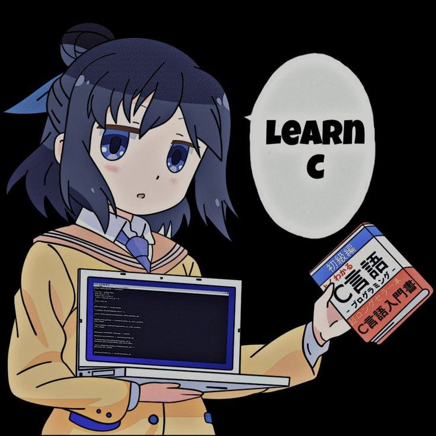

<samp>
    落ち着いて —  "ochitsuku"
      
    1. to calm down; 
    2. to compose oneself; 
    3. to regain presence of mind
      
    c, rust, js, ts, react
      
</samp>
<table>
  <tr>
    <td align="center" height="60">
      
    </td>
    <td align="center" height="60">
      
    </td>
  </tr>
  <tr>
    <td align="center"><samp>tmorres</samp></td>
    <td align="center"><samp>ochitsu</samp></td>
  </tr>
</table>
